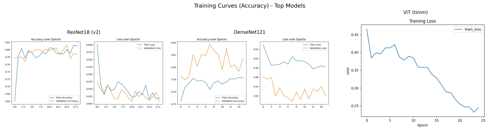
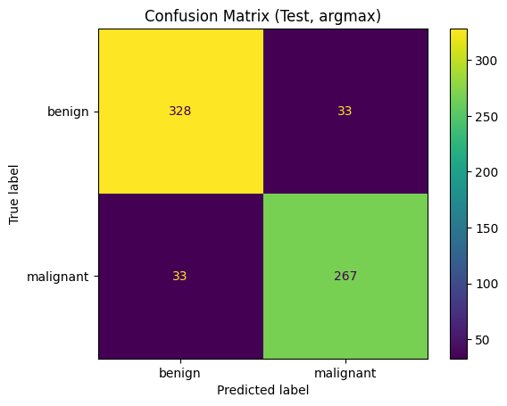
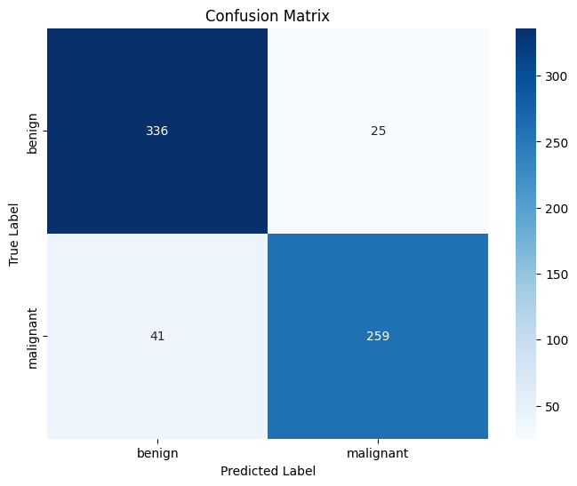

<p align="center">
  
</p>

<h1 align="center">Skin Cancer Detection</h1>

<p align="center">
  <strong>8-Model Benchmark for Binary Skin Lesion Classification + Multi-Class ViT Classifier</strong>
</p>

<p align="center">
  
  
  
  
  
  
</p>

---

## Overview

Systematic comparison of 8 deep learning architectures for binary skin lesion classification (benign vs malignant), plus a multi-class ViT classifier for 11 lesion types. Each model is trained, evaluated, and documented with confusion matrices, ROC curves, PR curves, and training dynamics.

Includes two interactive applications for real-time inference — a Streamlit app and a full-stack Vision Studio (FastAPI + React).

---

## Model Comparison — Binary Classification (Benign vs Malignant)

| Model | Accuracy | Macro F1 | ROC-AUC | PR-AUC | Pretrained On |
|:------|:--------:|:--------:|:-------:|:------:|:--------------|
| **EfficientNetV2-S** | **91.5%** | **0.91** | **0.964** | **0.956** | ImageNet-21K → 1K |
| ViT-Small/16 | 90.3% | 0.90 | 0.972 | 0.970 | ImageNet-21K → 1K |
| ConvNeXt-Tiny | 90.2% | 0.89 | 0.958 | 0.957 | ImageNet-12K → 1K |
| DenseNet121 | 90.0% | 0.90 | 0.554 | 0.502 | ImageNet-1K |
| ResNet18 (v2) | 90.0% | 0.90 | 0.435 | 0.403 | ImageNet-1K |
| ResNet18 (v3) | 89.0% | 0.89 | 0.430 | 0.407 | ImageNet-1K |
| Custom CNN | 83.0% | 0.83 | 0.488 | 0.498 | None (from scratch) |
| MobileNetV3-Large | 83.0% | 0.83 | 0.265 | 0.325 | ImageNet-1K |

> Models pretrained on ImageNet-21K (ViT, EfficientNetV2, ConvNeXt) significantly outperform ImageNet-1K models in ROC-AUC, showing the value of larger pretraining datasets for medical imaging.

### ROC Curve Comparison (Top Models)

<p align="center">
  
</p>

### Training Dynamics

<p align="center">
  
  
</p>

### Confusion Matrices

<p align="center">
  
  
  
</p>

---

## Multi-Class Classification (MILK-10K — 11 Lesion Types)

Using ViT with Latent Fusion on the MILK-10K dataset for fine-grained lesion classification:

| Class | Support | F1 Score |
|:------|--------:|---------:|
| BCC (Basal Cell Carcinoma) | 378 | 0.87 |
| NV (Melanocytic Nevus) | 112 | 0.73 |
| SCCKA (Squamous Cell / Keratoacanthoma) | 98 | 0.71 |
| AKIEC (Actinic Keratosis) | 19 | 0.65 |
| MEL (Melanoma) | 68 | 0.53 |
| BKL (Benign Keratosis) | 82 | 0.47 |
| DF (Dermatofibroma) | 8 | 0.43 |
| INF (Infection) | 7 | 0.31 |
| VASC (Vascular Lesion) | 7 | 0.77 |

**Overall Accuracy: 74%** | **Weighted F1: 0.74**

Top confusion pairs: BKL↔BCC, MEL↔NV, SCCKA↔BCC — clinically expected overlaps.

---

## Applications

### Streamlit App (`app/app.py`)
Single-file classifier with model selection, image upload, probability visualization, and light/dark theming.

```bash
cd app
pip install streamlit torch torchvision timm pillow
streamlit run app.py
```

### Vision Studio (`app/vision-studio-*`)
Full-stack application with FastAPI inference backend and React + TypeScript frontend.

```bash
# Backend
cd app/vision-studio-backend
pip install -r requirements.txt
uvicorn main:app --reload --port 8000

# Frontend (separate terminal)
cd app/vision-studio-ui
npm install
npm run dev
```

Or run both together:
```bash
cd app
python run_app.py
```

---

## Project Structure

```
Skin-Cancer-Detection/
├── notebooks/
│   ├── binary-classification/          # Top models (EfficientNetV2, ViT, ConvNeXt)
│   ├── multiclass/                     # ViT LatentFusion on MILK-10K
│   └── baselines/                      # Custom CNN, ResNet, DenseNet, MobileNet
├── app/
│   ├── app.py                          # Streamlit classifier app
│   ├── model_registry.py               # Model definitions and loading
│   ├── run_app.py                      # Launch backend + frontend together
│   ├── vision-studio-backend/          # FastAPI inference server
│   └── vision-studio-ui/               # React + TypeScript frontend
├── models/                             # Trained model weights (.pth)
├── figures/                            # All evaluation plots
│   ├── Fig_X*_confusion_*.png          # Confusion matrices
│   ├── Fig_Y*_training_*.png           # Training curves
│   ├── Fig_Z*_roc/pr_*.png            # ROC and PR curves
│   └── results_discussion_8models/     # Per-model detailed plots
├── results/                            # Evaluation metrics (CSV/XLSX)
├── docs/                               # Per-model training reports
└── docs_reports/                       # Results discussion documents
```

---

## Tech Stack

| Component | Technology |
|:----------|:-----------|
| **Training** | PyTorch, timm (PyTorch Image Models) |
| **Models** | EfficientNetV2-S, ViT-Small/16, ConvNeXt-Tiny, DenseNet121, ResNet18, MobileNetV3, Custom CNN |
| **Data** | torchvision transforms, PIL, NumPy |
| **App (Streamlit)** | Streamlit, PyTorch |
| **App (Vision Studio)** | FastAPI, React 18, TypeScript, Tailwind CSS, shadcn/ui |
| **Evaluation** | scikit-learn (classification report, ROC, PR curves), matplotlib |

---

## Key Findings

1. **Pretraining dataset matters more than architecture** — ViT, EfficientNetV2, and ConvNeXt all achieve >0.95 ROC-AUC when pretrained on ImageNet-21K, while the same architectures on ImageNet-1K score <0.55.

2. **Accuracy alone is misleading** — ResNet18 and DenseNet121 achieve 90% accuracy but only 0.43-0.55 ROC-AUC, meaning their probability calibration is poor. They predict the right class but with unreliable confidence scores.

3. **EfficientNetV2-S is the best overall** — Highest accuracy (91.5%), strong ROC-AUC (0.964), and the most balanced benign/malignant F1 scores.

4. **Multi-class is hard** — The MILK-10K 11-class task reaches 74% accuracy. Main confusions are between clinically similar lesion types (melanoma vs nevus, squamous cell vs basal cell).
