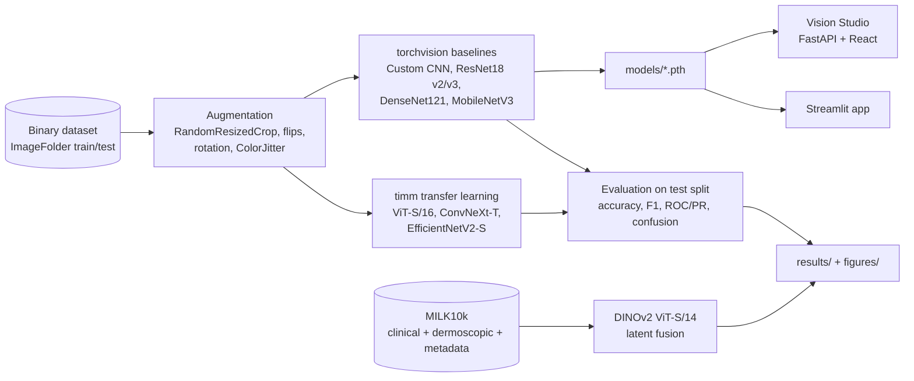
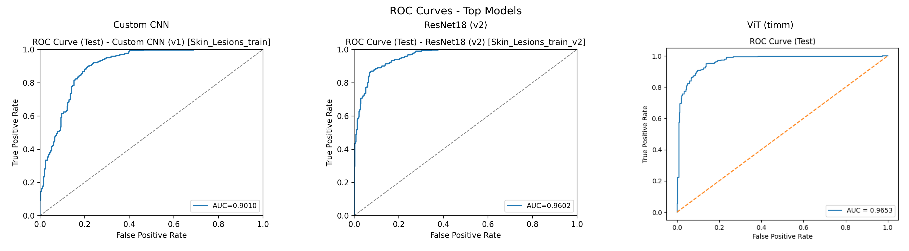
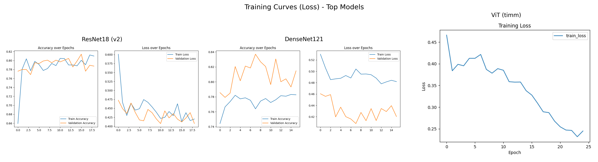
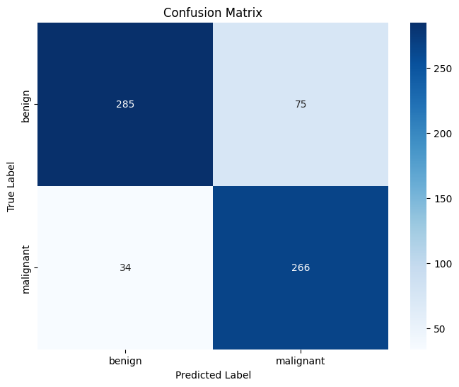
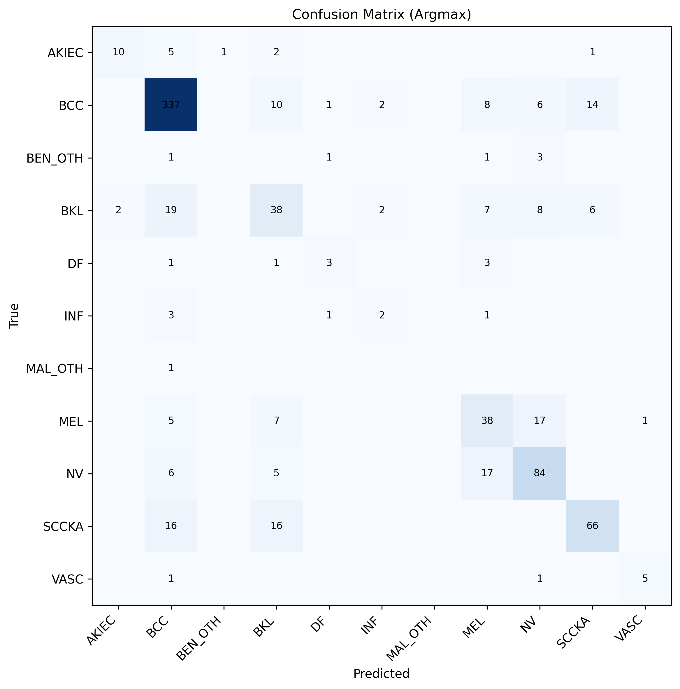

<h1 align="center">Skin Cancer Detection</h1>

<p align="center">
  <strong>Benchmark of 8 CNN / Vision Transformer models for benign-vs-malignant skin lesion classification, an 11-class multimodal classifier on MILK10k, and two inference apps.</strong>
</p>

<p align="center">
  
  
  
  
  
  
  
  
</p>

> [!WARNING]
> Research code only. None of these models is a medical device or clinically validated; do not use the outputs for diagnosis.

## Contents

- [Overview](#overview)
- [Highlights](#highlights)
- [Pipeline](#pipeline)
- [Results: binary classification](#results-binary-classification-benign-vs-malignant)
- [Results: MILK10k multi-class](#results-milk10k-11-class)
- [Key findings](#key-findings)
- [Applications](#applications)
- [Getting started](#getting-started)
- [Project structure](#project-structure)
- [Datasets](#datasets)
- [Related repositories](#related-repositories)
- [References](#references)
- [License](#license)

## Overview

**Problem.** Telling malignant from benign skin lesions in dermoscopic images, and, harder, separating 11
diagnostic categories when classes are heavily imbalanced.

**Approach.** Eight models are trained on the same binary dataset (2,637 train / 661 test images): a custom
CNN, ResNet18 (two variants), DenseNet121 and MobileNetV3-Large from torchvision, and ViT-Small/16, ConvNeXt-Tiny and
EfficientNetV2-S from `timm`. Each is evaluated with confusion matrices, ROC / PR curves and training curves. A second
track trains a DINOv2 ViT-S/14 model that fuses clinical and dermoscopic views with patient metadata on MILK10k.

**Result.** EfficientNetV2-S gives the best test accuracy (**91.5%**, macro-F1 0.91) and ViT-Small/16 the best
ROC-AUC (**0.972**). The MILK10k model reaches **74.2%** top-1 accuracy but only **0.48** balanced accuracy, because
rare classes are mostly missed.

## Highlights

- One test set (361 benign / 300 malignant) shared by all 8 binary models, with per-model metrics in
  [`results/results_summary_8models.csv`](results/results_summary_8models.csv).
- The `timm` notebooks select the checkpoint on a 20% validation split carved out of the training folder, then report on the untouched test folder.
- Multimodal MILK10k model: DINOv2 ViT-S/14 tokens from clinical and dermoscopic images plus age / sex / site
  metadata, with a lesion-level stratified 85/15 split so paired views stay together.
- Two inference front-ends: a single-file **Streamlit** app and **Vision Studio** (FastAPI + React) with a
  side-by-side model comparison page.

## Pipeline



## Results: binary classification (benign vs malignant)

Test split: 661 images (one notebook evaluates 660). Source: `results/results_summary_8models.csv`.

| Model | Pretraining | Test accuracy | Macro-F1 | ROC-AUC | PR-AUC |
|:------|:------------|:-------------:|:--------:|:-------:|:------:|
| **EfficientNetV2-S** (timm) | ImageNet-21k → 1k | **91.5%** | **0.907** | 0.964 | 0.956 |
| ViT-Small/16 (timm) | ImageNet-21k → 1k | 90.3% | 0.895 | **0.972** | **0.970** |
| ConvNeXt-Tiny (timm) | ImageNet-12k → 1k | 90.2% | 0.890 | 0.958 | 0.957 |
| DenseNet121 | ImageNet-1k | 90.0% | 0.90 | 0.554\* | 0.502\* |
| ResNet18 (v2) | ImageNet-1k | 90.0% | 0.90 | 0.435\* | 0.403\* |
| ResNet18 (v3) | ImageNet-1k | 89.0% | 0.89 | 0.430\* | 0.407\* |
| Custom CNN (v1) | none | 83.0% | 0.83 | 0.488\* | 0.498\* |
| MobileNetV3-Large | ImageNet-1k | 83.0% | 0.83 | 0.265\* | 0.325\* |

\* For the five torchvision baselines, ROC-AUC and PR-AUC come from a post-hoc cell run separately from training
(it expects `model` to already be in memory). The values contradict those models' 83–90% accuracy: an AUC below 0.5
together with 90% accuracy is not possible for the same predictions. The likely cause is that the cell scored a
different model state than the one that produced the accuracy, so **treat these AUCs as an evaluation bug, not a
property of the models.** The earlier ROC plots in `figures/Fig_Z1_roc_top_models.png` support this: they show
AUC 0.901 for the Custom CNN and 0.960 for ResNet18 (v2), which fits their accuracy. The accuracy and F1 figures come
from the in-notebook classification reports.

<p align="center">
  
</p>
<p align="center"><sub>ROC curves on the test split for the Custom CNN, ResNet18 (v2) and ViT-S/16, from an earlier evaluation run (more PR curves in <code>figures/Fig_Z2_pr_top_models.png</code>).</sub></p>

<details>
<summary>Training curves and confusion matrices</summary>

<p align="center">
  
  
</p>

<p align="center">
  
  
  
</p>

Per-model plots (ROC, PR, training curves, evaluation panels) are in
[`figures/results_discussion_8models/`](figures/results_discussion_8models/), and a ResNet18 failure-case grid is at
[`figures/binary_resnet18_v2__failure_cases.png`](figures/binary_resnet18_v2__failure_cases.png).

</details>

## Results: MILK10k (11-class)

DINOv2 ViT-S/14 with latent fusion of clinical and dermoscopic images plus metadata (notebook
`notebooks/multiclass/MILK10k_ViT_LatentFusion_v2_from_metadata.ipynb`), evaluated on a 15% lesion-level stratified
validation split (786 lesions). Argmax predictions; source `results/milk10k_classification_report_argmax.txt`.

| Metric | Value |
|:--|--:|
| Top-1 accuracy | **0.742** |
| Balanced accuracy | 0.476 |
| Macro-F1 | 0.50 |
| Weighted F1 | 0.74 |

<details>
<summary>Per-class F1</summary>

| Class | Support | Precision | Recall | F1 |
|:------|--------:|----------:|-------:|---:|
| BCC (basal cell carcinoma) | 378 | 0.85 | 0.89 | 0.87 |
| VASC (vascular lesion) | 7 | 0.83 | 0.71 | 0.77 |
| NV (melanocytic nevus) | 112 | 0.71 | 0.75 | 0.73 |
| SCCKA (squamous cell carcinoma / keratoacanthoma) | 98 | 0.76 | 0.67 | 0.71 |
| AKIEC (actinic keratosis / intraepidermal carcinoma) | 19 | 0.83 | 0.53 | 0.65 |
| MEL (melanoma) | 68 | 0.51 | 0.56 | 0.53 |
| BKL (benign keratosis) | 82 | 0.48 | 0.46 | 0.47 |
| DF (dermatofibroma) | 8 | 0.50 | 0.38 | 0.43 |
| INF (inflammatory / infectious) | 7 | 0.33 | 0.29 | 0.31 |
| BEN_OTH (other benign) | 6 | 0.00 | 0.00 | 0.00 |
| MAL_OTH (other malignant) | 1 | 0.00 | 0.00 | 0.00 |

Top confusions: BKL↔BCC, MEL↔NV, SCCKA↔BCC (`results/milk10k_top_confusions.csv`). The multi-label
`@0.5`-threshold metrics in `results/milk10k_results.csv` (macro-F1 0.08) are much lower than the argmax metrics because
the sigmoid outputs are poorly calibrated for thresholding.

<p align="center">
  
</p>

</details>

## Key findings

1. **The three `timm` models are the most reliable results.** They were trained and evaluated in one pipeline, with
   checkpoint selection on a validation split and a single pass over the test set. All three reach 90–91.5% accuracy
   with ROC-AUC between 0.958 and 0.972.
2. **The baselines' accuracy is competitive, but their tabulated AUCs are untrustworthy** (see the note under the
   table). An earlier ROC plot puts ResNet18 (v2) at 0.960 AUC, close to the `timm` models, so a clean re-evaluation
   of all baselines is needed before saying that pretraining scale matters more than architecture.
3. **EfficientNetV2-S is the best all-rounder** on this split: highest accuracy and macro-F1, and the most balanced
   benign / malignant F1 (0.92 / 0.91).
4. **The 11-class task is dominated by imbalance**: BCC has 378 validation lesions and MAL_OTH has 1. Accuracy
   (74%) looks far better than balanced accuracy (48%), and the errors fall between clinically similar classes.

## Applications

Both apps load the torchvision checkpoints from [`models/`](models/). Vision Studio also lists the three `timm`
models, but their checkpoints (`best_*.pt`) are not committed. Produce them by running the
`notebooks/binary-classification/` notebooks and copying the files into `models/`.

| App | Location | What it does |
|:----|:---------|:-------------|
| Streamlit classifier | `app/app.py` | Model picker, image upload, class probabilities, light/dark theme |
| Vision Studio backend | `app/vision-studio-backend/` | FastAPI inference API with a model registry and cached models |
| Vision Studio UI | `app/vision-studio-ui/` | React + TypeScript + shadcn/ui; upload view and model comparison page |

## Getting started

```bash
git clone https://github.com/rupeshbharambe24/Skin-Cancer-Detection.git
cd Skin-Cancer-Detection
python -m venv .venv && source .venv/bin/activate      # Windows: .venv\Scripts\activate
pip install -r requirements.txt
```

**Streamlit app**

```bash
cd app
streamlit run app.py
```

**Vision Studio** (backend on :8000, UI on :5173)

```bash
# Backend
cd app/vision-studio-backend
pip install -r requirements.txt
uvicorn main:app --reload --port 8000

# Frontend (second terminal)
cd app/vision-studio-ui
cp .env.example .env          # VITE_API_URL, defaults to http://127.0.0.1:8000
npm install
npm run dev
```

Or start both with `python app/run_app.py`.

**Training / evaluation**: place the binary dataset at `data/Skin Lesions Classification/{train,test}/{benign,malignant}/`
(see [Datasets](#datasets)) and run the notebooks under `notebooks/`. All notebooks were run on Windows with
Python 3.11 (`docs_reports/env_info.txt`).

## Project structure

```text
Skin-Cancer-Detection/
├── notebooks/
│   ├── binary-classification/   # timm: ViT-S/16, ConvNeXt-T, EfficientNetV2-S (+ combined notebook)
│   ├── baselines/               # Custom CNN, ResNet18 v2/v3, DenseNet121, MobileNetV3, DermaMNIST experiment
│   └── multiclass/              # MILK10k DINOv2 latent-fusion (v2, v3)
├── app/
│   ├── app.py                   # Streamlit classifier
│   ├── model_registry.py        # architectures + weight paths for the Streamlit app
│   ├── run_app.py               # starts Vision Studio backend + UI together
│   ├── vision-studio-backend/   # FastAPI inference server
│   └── vision-studio-ui/         # React + Vite frontend (.env.example inside)
├── models/                      # torchvision checkpoints (.pth) used by both apps
├── figures/                     # confusion matrices, ROC/PR, training curves (PNG + PDF)
│   └── results_discussion_8models/
├── results/                     # metric tables (CSV / XLSX) and MILK10k reports
├── docs/                        # per-notebook training reports (.docx)
├── docs_reports/                # generated results-and-discussion reports + environment info
├── requirements.txt
└── LICENSE
```

## Datasets

Datasets are **not** included; download them separately.

- **Binary (benign vs malignant)**: an ImageFolder-style dataset ("Skin Lesions Classification") with 1,440 / 1,197
  benign / malignant training images and 361 / 300 test images (`figures/binary_dataset_counts.csv`). The split sizes
  match the public ISIC-derived Kaggle dataset *Skin Cancer: Malignant vs. Benign*; the exact source is not recorded
  in the notebooks.
- **MILK10k**: ISIC multimodal benchmark (paired clinical close-up and dermoscopic images, 11 diagnostic categories,
  with metadata). Check the ISIC licence terms (non-commercial use) before using it.
- **DermaMNIST** (MedMNIST), only in `notebooks/baselines/MNIST_skin_cancer_model.ipynb`.

## Related repositories

| Repository | Description |
|:-----------|:------------|
| **Skin-Cancer-Detection** (this repo) | Training notebooks, results, checkpoints and the integrated apps |
| [vision-studio-ui](https://github.com/rupeshbharambe24/vision-studio-ui) | Earlier UI-only prototype of the Vision Studio frontend (placeholder data); superseded by `app/vision-studio-ui` here |

## References

<details>
<summary>Papers consulted during the project (not redistributed here)</summary>

- H. L. Gururaj et al., "DeepSkin: A Deep Learning Approach for Skin Cancer Classification," *IEEE Access*, 2023. doi:10.1109/ACCESS.2023.3274848
- A. Magdy et al., "Performance Enhancement of Skin Cancer Classification Using Computer Vision," *IEEE Access*, 2023. doi:10.1109/ACCESS.2023.3294974
- A. Imran et al., "Skin Cancer Detection Using Combined Decision of Deep Learners," *IEEE Access*, 2022. doi:10.1109/ACCESS.2022.3220329
- O. Akinrinade and C. Du, "Skin cancer detection using deep machine learning techniques," *Intelligence-Based Medicine* 11, 2025, 100191. doi:10.1016/j.ibmed.2024.100191
- K. B. Baabu and D. M. Raja S, "Skin Cancer Detection using Vision Transformer with GNN and Explainable AI (Grad-CAM)," AMATHE 2025. doi:10.1109/AMATHE65477.2025.11080709
- A. El Mahdi et al., "Fusion of Vision Transformer and VGG Features for Enhanced Skin Lesion Classification," ICCSC 2025. doi:10.1109/ICCSC66714.2025.11135399
- P. S. Prakash Kumar et al., "Design and Development of a Vision Transformer (ViT) Model for Predicting Skin Cancer from Skin Images," ICICCS 2025. doi:10.1109/ICICCS65191.2025.10984645
- P. Nayak et al., "Enhancing Early Skin Cancer Detection Through AI-Based Image Classification," ICOCT 2025. doi:10.1109/ICOCT64433.2025.11118333

</details>

## License

Code is released under the [MIT License](LICENSE). Datasets and pretrained backbones (timm, DINOv2) keep their own
licences.
